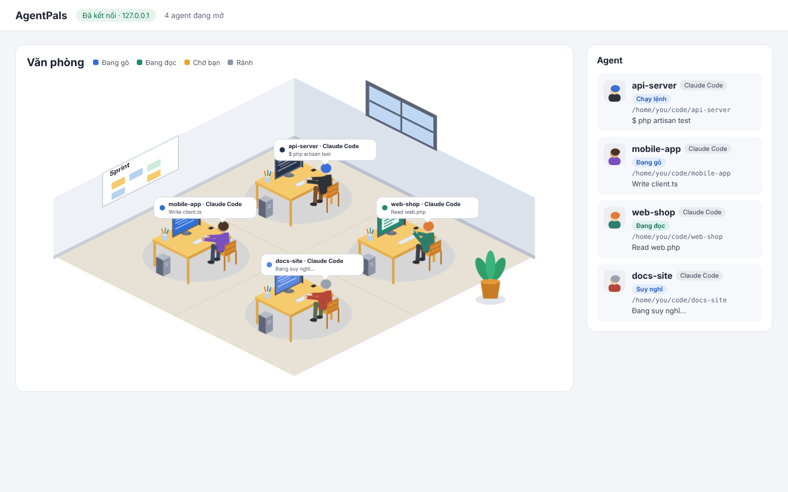

# AgentPals

Ứng dụng chạy local, biến các agent **Claude Code** / **Codex** đang chạy trên máy bạn thành những nhân vật ngồi trong một văn phòng isometric. Mỗi nhân vật gõ phím khi agent sửa file, đọc khi agent tìm kiếm, và giơ tay khi agent cần bạn duyệt. Nhân vật tuỳ chỉnh được tên, ngoại hình và câu nói.



> Trạng thái: đang xây dựng. Ý tưởng lấy cảm hứng từ pixel-agents; toàn bộ code và hình ảnh ở đây là tự viết.

## Chạy thử

Yêu cầu: Node 20+, pnpm.

```bash
pnpm install
pnpm install-hooks   # thêm hook AgentPals vào ~/.claude/settings.json (có backup)
pnpm dev             # server :4777 + UI Vite :5173 (hot reload)
```

Mở link `http://127.0.0.1:5173/?token=...` mà server in ra, rồi mở Claude Code ở một project bất kỳ. Terminal của server sẽ in các event (`→ typing · Edit foo.ts`, `→ waiting`, …) và UI cập nhật danh sách agent.

Chưa muốn đụng vào Claude Code? Trong lúc `pnpm dev` đang chạy, mở terminal khác chạy `pnpm demo` để xem 4 agent giả.

Dùng hằng ngày (1 tiến trình, 1 port): `pnpm start` sẽ build UI rồi chạy server, mở `http://127.0.0.1:4777/?token=...`.

Gỡ hook: `pnpm uninstall-hooks`.

## Cách hoạt động

```
Claude Code ──hook (stdin JSON)──> hooks/claude-hook.mjs ──POST /hook/claude──> server
                                                                      │  mapClaudeHook → AgentEvent
                                                                      │  applyEvent → AgentState
                                                              WebSocket /ws
                                                                      ▼
                                                                React UI
```

- `packages/core` – kiểu `AgentEvent`, `AgentState`, reducer `applyEvent`.
- `packages/server` – Hono + ws, provider Claude, cài/gỡ hook, CLI.
- `packages/ui` – React + Vite, văn phòng isometric vẽ bằng SVG. Server phục vụ bản build trên cùng port.
- `hooks/claude-hook.mjs` – script Claude Code gọi; luôn exit 0, không bao giờ làm chậm agent.

## Bảo mật

- Server chỉ bind `127.0.0.1`.
- Mọi request cần token trong `~/.agentpals/token` (tạo tự động, quyền 600). Đừng chia sẻ URL có `?token=`.

## Lộ trình

1. ✅ Khung monorepo, CI
2. ✅ Hook Claude Code → server → console
3. ✅ WebSocket → UI danh sách agent
4. ✅ Văn phòng isometric SVG + 4 trạng thái + bong bóng thoại
5. ⬜ Provider Codex (`~/.codex/sessions/*.jsonl`)
6. ⬜ Màn tuỳ chỉnh nhân vật, lưu `~/.agentpals/config.yaml`
7. ⬜ README có GIF demo

## License

MIT
